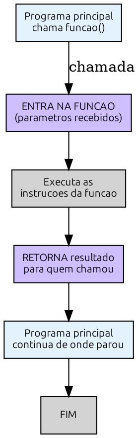

# Capítulo 4 — Vetores, Listas e Funções

**Objetivos deste capítulo:**
- Entender o que são listas (vetores) e por que são úteis
- Criar, acessar e percorrer listas
- Conhecer matrizes (listas de listas)
- Compreender o conceito de funções
- Criar funções com parâmetros e retorno
- Entender escopo de variáveis

---

## O problema que listas resolvem

Imagine que você precisa guardar os IPs dos servidores que monitora. Sem listas, você faria:

```pseudocode
ip1 = "192.168.1.10"
ip2 = "192.168.1.11"
ip3 = "192.168.1.12"
ip4 = "192.168.1.13"
ip5 = "192.168.1.14"
```

Até aí, ok. Mas agora você precisa testar se cada um responde ao ping. Com variáveis separadas:

```pseudocode
Pingar(ip1)
Pingar(ip2)
Pingar(ip3)
Pingar(ip4)
Pingar(ip5)
```

Funciona para 5. E para 50 servidores? Ou 500? Você teria que escrever 500 linhas de código quase idênticas. Além de cansativo, é propenso a erro — um descuido e você esquece o ip423.

**Listas resolvem isso.** Uma lista (também chamada de vetor ou array) é uma variável que guarda **múltiplos valores** sob um único nome.

---

## O que é uma lista?

Uma lista é como uma **prateleira com gavetas numeradas**. Cada gaveta guarda um valor, e você acessa pelo número da gaveta (chamado de **índice**).

```
Lista: servidores
┌────────┬────────┬────────┬────────┬────────┐
│ 192.16 │ 192.16 │ 192.16 │ 192.16 │ 192.16 │
│ 8.1.10 │ 8.1.11 │ 8.1.12 │ 8.1.13 │ 8.1.14 │
├────────┼────────┼────────┼────────┼────────┤
│ [1]    │ [2]    │ [3]    │ [4]    │ [5]    │
└────────┴────────┴────────┴────────┴────────┘
```

Em Portugol:

```pseudocode
servidores = ["192.168.1.10", "192.168.1.11", "192.168.1.12", "192.168.1.13", "192.168.1.14"]
```

Para acessar um elemento, usamos o nome da lista e o índice entre colchetes:

```pseudocode
ESCREVER servidores[1]    // Exibe "192.168.1.10"
ESCREVER servidores[3]    // Exibe "192.168.1.12"
```

> **Importante:** No Portugol (e em muitas linguagens), a contagem dos índices **começa em 1**. O primeiro elemento está na posição 1, o segundo na 2, e assim por diante. Python começa em 0 — mas veremos isso na Parte 2.

### Exemplo 1 — Exibir todos os servidores

```pseudocode
INICIO
    servidores = ["192.168.1.10", "192.168.1.11", "192.168.1.12", "192.168.1.13", "192.168.1.14"]
    PARA i DE 1 ATE 5 FACA
        ESCREVER "Servidor ", i, ": ", servidores[i]
    FIMPARA
FIM
```

Saída:
```
Servidor 1: 192.168.1.10
Servidor 2: 192.168.1.11
Servidor 3: 192.168.1.12
Servidor 4: 192.168.1.13
Servidor 5: 192.168.1.14
```

Percebeu? O `PARA` percorre a lista automaticamente. Se a lista tivesse 500 elementos, bastaria mudar o `ATE 5` para `ATE 500`.

### Exercício 1 — Lista de senhas

Crie uma lista com 6 senhas comuns ("123456", "senha", "admin", "password", "qwerty", "letmein"). Depois escreva um algoritmo que exiba cada senha e sua posição na lista.

---

## Operações com listas

Além de acessar elementos, você pode modificar listas dinamicamente.

### Tamanho da lista — COMPRIMENTO

Antes de percorrer uma lista, é útil saber quantos elementos ela tem:

```pseudocode
servidores = ["192.168.1.10", "192.168.1.11", "192.168.1.12"]
total = COMPRIMENTO(servidores)   // total = 3
```

### Adicionar elementos — ADICIONAR

```pseudocode
servidores = ["192.168.1.10", "192.168.1.11"]
ADICIONAR "192.168.1.12" NA servidores
// servidores agora tem 3 elementos
```

### Remover elementos — REMOVER

```pseudocode
servidores = ["192.168.1.10", "192.168.1.11", "192.168.1.12"]
REMOVER "192.168.1.11" DE servidores
// servidores agora tem 2 elementos: o 1.10 e o 1.12
```

### Exemplo 2 — Gerenciando lista de tarefas

```
INICIO
    tarefas = []
    ADICIONAR "Verificar logs do firewall" NA tarefas
    ADICIONAR "Atualizar assinaturas do antivirus" NA tarefas
    ADICIONAR "Revisar relatorio de vulnerabilidades" NA tarefas
	
    ESCREVER "Tarefas pendentes:"
    PARA i DE 1 ATE COMPRIMENTO(tarefas) FACA
        ESCREVER i, ". ", tarefas[i]
    FIMPARA
FIM
```

### Exercício 2 — Lista de portas abertas

Crie uma lista vazia chamada `portas_abertas`. Adicione manualmente 4 portas conhecidas (22, 80, 443, 3306). Depois:

1. Exiba o total de portas na lista
2. Exiba cada porta em uma linha
3. Remova a porta 3306
4. Exiba a lista novamente

---

## Matrizes — listas de listas

Uma matriz é uma lista onde cada elemento também é uma lista. É como uma **planilha** com linhas e colunas.

Imagine que você quer guardar nome, IP e porta de cada servidor:

```
servidores = [
    ["Servidor Web", "192.168.1.10", 443],
    ["Servidor BD",  "192.168.1.11", 3306],
    ["DNS",          "192.168.1.12", 53]
]
```

Para acessar um elemento, usamos dois índices: `[linha][coluna]`:

```pseudocode
ESCREVER servidores[1][1]   // "Servidor Web"
ESCREVER servidores[2][2]   // "192.168.1.11"
ESCREVER servidores[3][3]   // 53
```

### Exemplo 3 — Exibindo a tabela de servidores

```
INICIO
    servidores = [
        ["Servidor Web", "192.168.1.10", 443],
        ["Servidor BD",  "192.168.1.11", 3306],
        ["DNS",          "192.168.1.12", 53]
    ]
	
    ESCREVER "Nome              IP              Porta"
    ESCREVER "----------------------------------------"
    PARA i DE 1 ATE 3 FACA
        ESCREVER servidores[i][1], "       ", servidores[i][2], "     ", servidores[i][3]
    FIMPARA
FIM
```

### Exercício 3 — Tabela de permissões

Crie uma matriz `acessos` com 4 usuários e 3 colunas: nome, nível (1, 2, 3) e setor.

Depois escreva um algoritmo que exiba apenas os usuários com nível 2 ou superior.

---

## Funções — a caixa de ferramentas

Agora vamos subir um degrau. Você já usou funções sem perceber: `ESCREVER`, `LER`, `COMPRIMENTO`, `ADICIONAR` — todas são funções. Alguém as escreveu para que você pudesse usar sem se preocupar com a implementação.

Uma **função** é um bloco de código que:
1. Tem um **nome** (para você chamá-la)
2. Pode receber **parâmetros** (dados de entrada)
3. Pode **retornar** um valor (dado de saída)
4. Executa uma tarefa específica



### Por que usar funções?

- **Reuso** — escreva uma vez, use em vários lugares
- **Organização** — código mais limpo e fácil de entender
- **Testabilidade** — teste cada função isoladamente
- **Abstração** — você usa uma função sem precisar saber como ela funciona por dentro

No mundo da segurança, isso é ainda mais importante. Um scanner de portas chama uma função `conectar()` sem precisar saber se a conexão é TCP ou UDP. Um verificador de integridade chama `calcular_hash()` e confia no resultado. A complexidade fica escondida dentro da função.

### Sintaxe em Portugol

```
FUNCAO nome_da_funcao(parametro1, parametro2)
    // instrucoes
    RETORNAR valor
FIMFUNCAO
```

- `FUNCAO` / `FIMFUNCAO` delimitam a função
- Os **parâmetros** são variáveis que a função recebe para trabalhar
- `RETORNAR` devolve um valor para quem chamou a função
- Se a função não precisa retornar nada, simplesmente não use `RETORNAR`

### Exemplo 4 — Função para verificar se pode dirigir

```
FUNCAO pode_dirigir(idade)
    SE idade >= 18 ENTAO
        RETORNAR verdadeiro
    SENAO
        RETORNAR falso
    FIMFUNCAO

// Usando a função:
INICIO
    idade_usuario = 20
    SE pode_dirigir(idade_usuario) ENTAO
        ESCREVER "Pode dirigir"
    SENAO
        ESCREVER "Nao pode dirigir"
    FIMSE
FIM
```

Percebeu? A função `pode_dirigir` recebe a `idade` como parâmetro e retorna `verdadeiro` ou `falso`. Quem chama a função não precisa saber como a verificação é feita — só precisa do resultado.

### Exemplo 5 — Função para somar dois números

```
FUNCAO somar(a, b)
    resultado = a + b
    RETORNAR resultado
FIMFUNCAO

// Usando:
INICIO
    total = somar(15, 27)
    ESCREVER "Total: ", total
FIM
```

### Exercício 4 — Função de validação de senha

Relembre o Capítulo 2, onde validamos senha com 3 regras. Agora transforme essa validação em uma função:

```
FUNCAO senha_valida(senha)
    // Verificar: tamanho >= 8 E tem maiuscula E tem numero
    // Retornar verdadeiro ou falso
FIMFUNCAO
```

Depois use a função num algoritmo que pede a senha e diz se é válida ou não.

---

## Funções com listas

Funções ficam ainda mais poderosas quando combinadas com listas.

### Exemplo 6 — Função para encontrar IP em lista

```
FUNCAO ip_existe(ip, lista_ips)
    PARA i DE 1 ATE COMPRIMENTO(lista_ips) FACA
        SE lista_ips[i] == ip ENTAO
            RETORNAR verdadeiro
        FIMSE
    FIMPARA
    RETORNAR falso
FIMFUNCAO

INICIO
    rede_local = ["192.168.1.10", "192.168.1.11", "192.168.1.12", "192.168.1.13"]
    ip_procurado = "192.168.1.50"
	
    SE ip_existe(ip_procurado, rede_local) ENTAO
        ESCREVER ip_procurado, " esta na rede local"
    SENAO
        ESCREVER ip_procurado, " NAO esta na rede local"
    FIMSE
FIM
```

### Exemplo 7 — Função para calcular média de latências

```
FUNCAO media_latencia(latencias)
    soma = 0
    PARA i DE 1 ATE COMPRIMENTO(latencias) FACA
        soma = soma + latencias[i]
    FIMPARA
    RETORNAR soma / COMPRIMENTO(latencias)
FIMFUNCAO

INICIO
    medicoes = [12, 15, 11, 14, 13, 200, 12]
    media = media_latencia(medicoes)
    ESCREVER "Latencia media: ", media, " ms"
FIM
```

### Exercício 5 — Funções de segurança

1. **Função `porta_conhecida(porta)`**: recebe um número de porta e retorna verdadeiro se for uma porta conhecida (22, 80, 443, 3306, 8080). Use uma lista interna com as portas conhecidas.

2. **Função `classificar_porta(porta)`**: recebe um número de porta e retorna:
   - "SSH" se for 22
   - "HTTP" se for 80
   - "HTTPS" se for 443
   - "MySQL" se for 3306
   - "Alternativo" se for 8080
   - "Desconhecido" para qualquer outra

3. **Função `senhas_fracas(senha)`**: recebe uma senha e uma lista de senhas fracas. Retorna verdadeiro se a senha estiver na lista (ou seja, é fraca).

---

## Escopo de variáveis — o que fica dentro e o que fica fora

Um conceito importante: variáveis criadas **dentro de uma função** só existem dentro dela. Variáveis criadas **fora** (no programa principal) não são vistas pela função a menos que sejam passadas como parâmetro.

```pseudocode
// Variável GLOBAL (fora de qualquer função)
nome_empresa = "Seguranca Total"

FUNCAO exibir_nome()
    // Variável LOCAL (só existe dentro da função)
    mensagem = "Bem-vindo!"
    ESCREVER mensagem
    ESCREVER nome_empresa   // Isso funciona? Depende da linguagem
FIMFUNCAO

INICIO
    exibir_nome()
    ESCREVER mensagem   // ERRO! 'mensagem' não existe aqui
FIM
```

A variável `mensagem` foi criada dentro de `exibir_nome` e **não pode ser acessada** fora dela. Já `nome_empresa` foi criada no programa principal — em alguns casos pode ser acessada de dentro da função, mas a **boa prática** é sempre passar como parâmetro.

> **Regra de ouro:** toda informação que uma função precisa deve vir pelos **parâmetros**. Toda informação que a função produz deve vir pelo **RETORNAR**. Isso torna o código previsível e fácil de testar.

---

## Revisitando o problema inicial — scanner de servidores

Agora, com listas e funções, podemos resolver o problema do início do capítulo de forma elegante:

```
FUNCAO pingar(ip)
    // Simula um ping (em Python faremos de verdade)
    ESCREVER "Pingando ", ip, "... OK"
    RETORNAR verdadeiro
FIMFUNCAO

FUNCAO verificar_servidores(lista_ips)
    PARA i DE 1 ATE COMPRIMENTO(lista_ips) FACA
        pingar(lista_ips[i])
    FIMPARA
FIMFUNCAO

INICIO
    servidores = ["192.168.1.10", "192.168.1.11", "192.168.1.12", "192.168.1.50"]
    verificar_servidores(servidores)
    ESCREVER "Verificacao concluida"
FIM
```

Veja como o código ficou:
- Uma função `pingar` que simula o teste em um IP
- Uma função `verificar_servidores` que percorre a lista chamando `pingar`
- O programa principal simplesmente cria a lista e chama a função

Se amanhã você precisar verificar 100 servidores, só muda a lista. Se precisar mudar a forma de pingar (usar pacote ICMP em vez de TCP), só muda a função `pingar`. O resto do código não precisa saber.

---

## Exercícios finais do capítulo

### Exercício 6 — Analisador de logs

Uma função recebe uma lista de entradas de log. Cada entrada é uma string como:

```
["192.168.1.10 - Falha de login", "192.168.1.11 - Acesso OK", "192.168.1.10 - Falha de login", "192.168.1.12 - Acesso OK"]
```

Escreva a função `contar_falhas(logs, ip)` que recebe a lista de logs e um IP, e retorna quantas vezes aquele IP aparece com "Falha de login".

Dica: use `PROCURAR(texto, palavra)` que retorna verdadeiro se a palavra está no texto.

### Exercício 7 — Blacklist dinâmica

Crie um sistema simples de blacklist:

```
FUNCAO esta_bloqueado(ip, blacklist)
    // Retorna verdadeiro se o IP está na blacklist
FIMFUNCAO

FUNCAO bloquear(ip, blacklist)
    // Adiciona o IP na blacklist, se ja nao estiver
FIMFUNCAO
```

Depois escreva um programa principal que:
1. Cria uma blacklist com 3 IPs iniciais
2. Pergunta um IP para o usuário
3. Se estiver na blacklist, exibe "BLOQUEADO"
4. Se não estiver, pergunta se o usuário quer adicionar
5. Exibe a blacklist atualizada

### Exercício 8 — Calculadora de sub-rede

Escreva uma função `ip_valido(ip)` que recebe uma string no formato "192.168.1.1" e verifica se ela tem 4 números separados por ponto, cada um entre 0 e 255.

Depois, use a função para filtrar uma lista de IPs, exibindo apenas os válidos.

---

## Resumo do Capítulo

- **Listas** armazenam múltiplos valores sob um único nome, acessíveis por índice
- **Matrizes** são listas de listas, úteis para dados tabulares
- **COMPRIMENTO**, **ADICIONAR** e **REMOVER** são operações básicas com listas
- **Funções** são blocos reutilizáveis de código que recebem parâmetros e retornam valores
- Funções tornam o código mais organizado, testável e reutilizável
- **Escopo** determina onde uma variável existe: dentro da função (local) ou no programa principal (global)
- A combinação **listas + funções + loops** é a base de praticamente todo programa útil

**Parabéns, você completou a Parte 1 do livro!**

Você aprendeu os fundamentos da lógica de programação: algoritmos, fluxogramas, decisões, loops, listas e funções. Tudo isso em Portugol, sem precisar de computador — apenas com papel, caneta e raciocínio.

Na **Parte 2**, vamos migrar todo esse conhecimento para Python. Você vai ver como cada conceito que aprendeu aqui se traduz em código real. E aí sim vamos começar a escrever ferramentas de segurança de verdade.