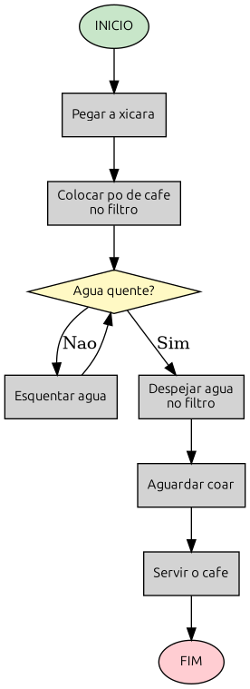
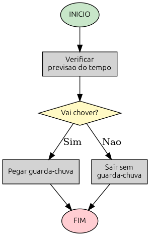
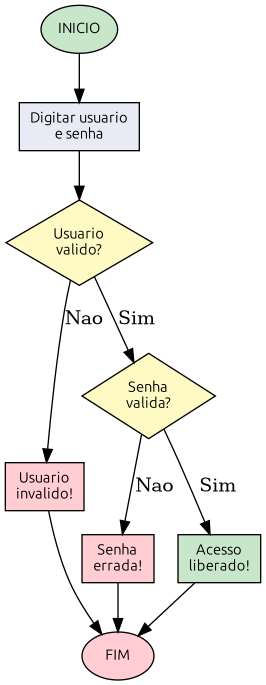

# Capítulo 1 — Pensamento Computacional

**Objetivos deste capítulo:**

* Entender o que é um algoritmo e por que ele importa
* Criar algoritmos do mundo real
* Representar algoritmos visualmente com fluxogramas
* Conhecer o Portugol (pseudocódigo)
* Compreender variáveis e tipos de dados

***

## O que é um algoritmo?

Imagine a seguinte situação.

Você acorda, levanta da cama e decide fazer um café. O que você faz? Provavelmente algo como:

1. Pegar a xícara
2. Colocar pó de café no filtro
3. Verificar se a água já está quente
4. Se estiver quente, despejar no filtro
5. Se não estiver, esquentar e depois despejar
6. Aguardar coar
7. Servir

Isso é um **algoritmo**. Um algoritmo é uma sequência de passos organizada e finita que resolve um problema. Você cria algoritmos o tempo todo sem perceber: quando segue uma receita, quando monta um móvel, quando dá instruções para alguém chegar a um lugar.

### O que torna um algoritmo bom?

Três características:

1. **Finito** — termina em algum momento. "Ferver a água até secar" não é bom, porque nunca termina (ou termina com a panela queimada).
2. **Definido** — cada passo é claro. "Colocar um pouco de café" é vago; "colocar duas colheres de sopa de café" é definido.
3. **Sequencial** — a ordem importa. Você não pode servir o café antes de coar.

Pense em um exemplo do seu dia a dia que exige passos em ordem. Escovar os dentes? Trocar um pneu? Configurar o roteador de um cliente? Tudo isso pode ser descrito como um algoritmo.

### Exercício 1 — Algoritmo do dia a dia

Escolha UMA atividade cotidiana (pode ser escovar os dentes, preparar um sanduíche, ou qualquer outra). Escreva os passos em ordem, numerados, como no exemplo do café.

Não use termos técnicos de computação — isso vem depois. Apenas os passos que qualquer pessoa entenderia.

***

## Fluxogramas — desenhando o algoritmo

Palavras funcionam, mas às vezes um desenho vale mais. Um **fluxograma** representa um algoritmo visualmente, usando formas geométricas padronizadas.

Veja o exemplo do café que descrevemos antes. Agora olhe para ele visualmente:



Percebe como fica mais fácil de entender? Você segue as setas com o olho e vê o fluxo: começa, passa por cada etapa, decide quando a água está quente ou não, e termina.

Outro exemplo, mais simples. A decisão de pegar ou não guarda-chuva antes de sair:



Este fluxograma mostra uma **decisão**: se chover, você pega o guarda-chuva; se não, sai sem ele. O losango (diamante) representa a pergunta. As setas indicam cada caminho possível.

### Os símbolos do fluxograma

| Forma         | Nome          | O que significa                                      |
| ------------- | ------------- | ---------------------------------------------------- |
| Elipse (oval) | Terminal      | Início e fim do algoritmo                            |
| Retângulo     | Processo      | Uma ação executada                                   |
| Losango       | Decisão       | Uma pergunta que pode ser Sim ou Não                 |
| Paralelogramo | Entrada/Saída | Ler dados ou mostrar resultado (usaremos mais tarde) |
| Seta          | Fluxo         | Direção do fluxo entre os passos                     |

### Exercício 2 — Seu primeiro fluxograma

Pegue o algoritmo que você escreveu no Exercício 1 e desenhe o fluxograma correspondente. Não se preocupe com ferramentas — papel e caneta servem perfeitamente. Desenhe as formas (elipse, retângulo, losango se houver decisão, setas) e escreva os passos dentro.

> **Dica:** Se o seu algoritmo tem uma decisão (ex: "se o café estiver pronto"), use um losango. Se não tem decisão nenhuma, você pode fazer só com retângulos em sequência — mas aí provavelmente seu algoritmo poderia ser mais interessante. Tente encontrar um momento de decisão.

***

## Portugol — o meio do caminho

Até agora trabalhamos com a vida real. Chegou a hora de dar um passo em direção ao computador, mas sem entrar em código ainda.

**Portugol** (ou pseudocódigo) é uma forma de escrever algoritmos usando uma linguagem estruturada que parece programa, mas ainda é em português. Não é Python — é uma ponte entre o raciocínio humano e a programação.

Veja o algoritmo do café escrito em Portugol:

```
INICIO
    Pegar xicara
    Colocar po no filtro
    SE agua_estiver_quente ENTAO
        Despejar agua no filtro
    SENAO
        Esquentar agua
        Despejar agua no filtro
    FIMSE
    Aguardar coar
    Servir cafe
FIM
```

Perceba as palavras novas:

* `INICIO` / `FIM` — delimitam o começo e o fim
* `SE` / `ENTAO` / `SENAO` / `FIMSE` — estrutura de decisão (nosso losango do fluxograma)
* As ações escritas em sequência

O Portugol não é executado por nenhum computador. É uma ferramenta de **raciocínio**. Antes de escrever código em Python, você vai descrever a solução em Portugol. Depois traduzir para Python fica muito mais fácil.

### Exercício 3 — Escreva em Portugol

Reescreva o algoritmo do Exercício 1 em Portugol, usando `INICIO` / `FIM` e `SE...ENTAO...SENAO` se houver decisão.

***

## Variáveis — guardando informações

Agora vamos entender um conceito fundamental: as **variáveis**.

Imagine que você tem uma caixa de papelão. Você escreve um nome nela — digamos, "idade". Dentro dela, você coloca um valor — por exemplo, 18.

```
  ┌─────────────────┐
  │     idade       │   ← Nome da variável (o rótulo da caixa)
  ├─────────────────┤
  │       18        │   ← Valor (o conteúdo)
  └─────────────────┘
```

Em programação, **variável** é exatamente isso: um espaço na memória do computador que tem um **nome** e guarda um **valor** que pode mudar.

O nome existe para você referenciar aquela informação depois. Em vez de decorar números, você usa o nome. "Qual a idade do usuário?" — `idade`.

### Tipos de dados — que tipo de coisa cabe na caixa?

Na vida real, você não guarda qualquer coisa em qualquer caixa. Leite vai na geladeira, ferramentas vão na caixa de ferramentas. Com variáveis é parecido — cada valor tem um **tipo**.

Os tipos mais comuns são:

| Tipo                | O que guarda        | Exemplo real           | Exemplo em Portugol      |
| ------------------- | ------------------- | ---------------------- | ------------------------ |
| **Inteiro** (int)   | Números sem vírgula | 18 anos, 3 andares     | `idade = 18`             |
| **Decimal** (float) | Números com vírgula | 36.5°C, R$ 19,90       | `temperatura = 36.5`     |
| **Texto** (string)  | Palavras, frases    | "João", "Rua A"        | `nome = "João"`          |
| **Lógico** (bool)   | Verdadeiro ou Falso | "A porta está aberta?" | `conectado = verdadeiro` |

### Exercício 4 — Identificando tipos

Uma central de monitoramento de rede coleta as seguintes informações sobre cada dispositivo:

1. Nome do host (ex: "SERVIDOR-01")
2. Endereço IP (ex: "192.168.1.10")
3. Quantidade de memória RAM em GB (ex: 16)
4. Temperatura da CPU em graus (ex: 68.5)
5. Status do serviço (online ou offline)
6. Versão do sistema operacional (ex: "Ubuntu 22.04")

Para cada item, diga qual tipo de dado seria usado (int, float, string, bool).

***

## Algoritmo de verdade — o problema do acesso

Agora vamos juntar tudo que aprendemos com um problema real que você pode encontrar no seu trabalho. Um sistema precisa **verificar se um usuário pode acessar** uma área restrita. As regras são:

* Se o usuário não existir no cadastro → acesso negado
* Se o usuário existir mas a senha estiver errada → acesso negado
* Se o usuário existir E a senha estiver correta → acesso liberado

Vamos construir do começo: algoritmo em português, fluxograma, e depois Portugol.

### Passo 1 — Algoritmo em português

1. Perguntar nome de usuário e senha
2. Verificar se o usuário existe
3. Se não existir, exibir "Usuário inválido" e encerrar
4. Se existir, verificar a senha
5. Se a senha estiver errada, exibir "Senha errada" e encerrar
6. Se a senha estiver correta, exibir "Acesso liberado"

### Passo 2 — Fluxograma

Aqui está a representação visual:



### Passo 3 — Portugol

```
INICIO
    LER usuario, senha
    SE usuario_existe ENTAO
        SE senha_correta ENTAO
            ESCREVER "Acesso liberado"
        SENAO
            ESCREVER "Senha errada"
        FIMSE
    SENAO
        ESCREVER "Usuario invalido"
    FIMSE
FIM
```

Perceba: usamos variáveis (`usuario`, `senha`), uma estrutura `SE...ENTAO...SENAO` dentro de outra, e saída de dados (`ESCREVER`). É o mesmo fluxograma, mas em texto estruturado.

***

## Nomes de variáveis — boas práticas

Assim como você não nomearia uma caixa de ferramentas de "c" (ninguém saberia o que é), variáveis devem ter nomes descritivos.

```pseudocode
INICIO
    idade = 18               // Bom: claro
    a = 18                    // Ruim: o que é "a"?
    nome_cliente = "João"    // Bom: descreve o conteúdo
    nc = "João"              // Ruim: ninguém sabe o que é "nc"
FIM
```

Regras que usaremos no livro:

* Nomes em português
* Use underline para separar palavras (`nome_cliente`)
* Seja descritivo (`ip_servidor_dns` em vez de `ipsd`)
* Não use espaços (o computador acha que são duas coisas)

***

## Exercícios finais do capítulo

### Exercício 5 — Algoritmo de madrugada

Você está no plantão noturno. O telefone toca. É um cliente dizendo que não consegue acessar a internet. Escreva em Portugol o algoritmo que você segue para diagnosticar o problema (pode ser simples: ping gateway, ping DNS, verificar DHCP, etc.).

### Exercício 6 — Traduzindo fluxograma

Dado o fluxograma abaixo, escreva o algoritmo correspondente em Portugol:

```
  [INICIO]
      │
      ▼
┌──────────────┐
│ Verificar    │
│ horário      │
└──────┬───────┘
       │
       ▼
   ┌────────┐
   │ Horário│
   │comerc.?│
   └───┬────┘
      / \
    Sim  Não
     /    \
    ▼     ▼
┌────────┐  ┌──────────┐
│"Sistema │  │"Plantão  │
│ online" │  │ ativo"   │
└────┬───┘  └────┬─────┘
     │           │
     └─────┬─────┘
           ▼
        [ FIM ]
```

### Exercício 7 — Que tipo é cada um?

Classifique cada valor pelo tipo adequado (int, float, string, bool):

| Valor         | Tipo |
| ------------- | :--: |
| 443           |      |
| 3.14          |      |
| "192.168.1.1" |      |
| verdadeiro    |      |
| -5            |      |
| "bloqueado"   |      |
| 0.001         |      |
| 1024          |      |

***

## Resumo do Capítulo

* **Algoritmo** é uma sequência finita, definida e ordenada de passos para resolver um problema
* **Fluxograma** representa o algoritmo visualmente: elipse (início/fim), retângulo (ação), losango (decisão), setas (fluxo)
* **Portugol** é o pseudocódigo em português que faz a ponte entre o raciocínio humano e a programação
* **Variável** é um espaço nomeado que guarda um valor mutável
* **Tipos** fundamentais: inteiro, decimal, texto e lógico
* Um problema pode ser resolvido em 3 etapas: (1) algoritmo em português, (2) fluxograma, (3) Portugol

No próximo capítulo vamos nos aprofundar nas **decisões** — o `SE...ENTAO...SENAO` — com exemplos práticos de verificação de senhas, validação de dados e controle de acesso.
