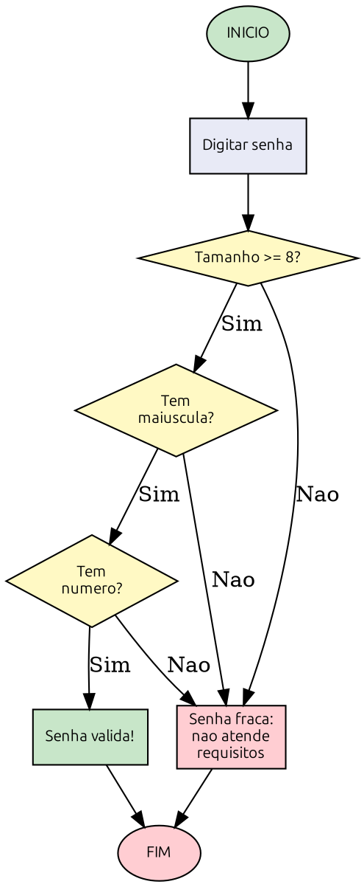

# Capítulo 2 — Decisões e Condições

**Objetivos deste capítulo:**

* Entender o que significa tomar uma decisão dentro de um algoritmo
* Usar estruturas condicionais: `SE`, `ENTÃO`, `SENÃO`
* Conhecer os operadores relacionais: `>`, `<`, `>=`, `<=`, `==`, `!=`
* Combinar condições com operadores lógicos: `E`, `OU`, `NÃO`
* Resolver problemas com decisões aninhadas

***

## O que é uma decisão?

No capítulo anterior, você viu que um algoritmo é uma sequência de passos. Mas a vida real não é uma linha reta — vivemos tomando decisões o tempo todo.

Você acorda e olha o tempo. Se estiver nublado, leva guarda-chuva. Se estiver sol, sai sem. Chega no trabalho: se o sistema do cliente está respondendo, faz o diagnóstico remoto. Se não está, precisa ir até o local. No fim do dia: se ainda tem energia, estuda um pouco. Se não, descansa.

Cada uma dessas situações tem algo em comum: **um ponto onde o fluxo se divide em dois ou mais caminhos, dependendo de uma condição**.

Em programação, isso se chama **estrutura condicional** ou **desvio condicional**. É a ferramenta que permite ao seu programa tomar decisões — e é o que torna um programa inteligente, em vez de uma mera lista fixa de instruções.

### Um exemplo simples

Imagine a seguinte situação:

> Você está em casa e quer sair. Antes de sair, olha pela janela. Se estiver chovendo, pega o guarda-chuva. Se não estiver, sai sem ele.

Em Portugol:

```
INICIO
    SE esta_chovendo ENTAO
        Pegar guarda-chuva
    SENAO
        Sair sem guarda-chuva
    FIMSE
FIM
```

Percebe a estrutura? A palavra `SE` abre uma pergunta. `ENTAO` diz o que fazer se a resposta for sim. `SENAO` diz o que fazer se for não. `FIMSE` fecha a estrutura.


***

## A estrutura SE...ENTÃO...SENÃO

A forma geral de uma decisão em Portugol é:

```
SE <condição> ENTAO
    (instruções se for verdadeiro)
SENAO
    (instruções se for falso)
FIMSE
```

A **condição** é uma pergunta que só pode ter duas respostas: **verdadeiro** ou **falso**. Em programação, isso se chama **expressão booleana** (em homenagem a George Boole, um matemático que criou a álgebra da lógica).

Não existe "mais ou menos". Não existe "talvez". A condição é sempre `verdadeiro` ou `falso` — como uma luz que ou está acesa ou apagada.

### Exemplo 1 — Maioridade

```
INICIO
    idade = 17
    SE idade >= 18 ENTAO
        ESCREVER "Pode entrar"
    SENAO
        ESCREVER "Menor de idade"
    FIMSE
FIM
```

Aqui, a condição `idade >= 18` pergunta: "a idade é maior ou igual a 18?". Se for verdadeiro, executa o bloco do `ENTAO`. Se for falso, executa o bloco do `SENAO`.

### Exemplo 2 — Status de serviço

```
INICIO
    ping_ok = falso
    SE ping_ok ENTAO
        ESCREVER "Servidor respondendo"
    SENAO
        ESCREVER "Servidor offline"
    FIMSE
FIM
```

Aqui a condição é diretamente um valor lógico (`verdadeiro` ou `falso`), sem comparação. Se `ping_ok` for verdadeiro, a mensagem é de sucesso.

### Exercício 1 — Algoritmo da ponte

Você está dirigindo e chega a uma ponte. Há uma placa: "Peso máximo: 10 toneladas". Seu veículo pesa 8 toneladas. Escreva em Portugol o algoritmo que decide se você pode ou não atravessar a ponte.

***

## Operadores Relacionais — fazendo perguntas

As condições geralmente envolvem **comparações**. Para isso, usamos os **operadores relacionais**:

| Operador | Significado    | Exemplo verdadeiro | Exemplo falso |
| :------: | -------------- | ------------------ | ------------- |
|    `>`   | Maior que      | `10 > 5`           | `3 > 8`       |
|    `<`   | Menor que      | `3 < 8`            | `10 < 5`      |
|   `>=`   | Maior ou igual | `5 >= 5`           | `4 >= 6`      |
|   `<=`   | Menor ou igual | `4 <= 6`           | `5 <= 4`      |
|   `==`   | Igual a        | `5 == 5`           | `5 == 3`      |
|   `!=`   | Diferente de   | `5 != 3`           | `5 != 5`      |

Repare em dois detalhes importantes:

1. **`==` (dois sinais de igual) é diferente de `=` (um sinal)**. Um sinal de igual (`=`) é para **atribuição** — guardar um valor numa variável. Dois sinais (`==`) é para **comparação** — perguntar se dois valores são iguais. Essa confusão é um dos erros mais comuns de quem está começando.
2. **`!=` significa "diferente de"**. O ponto de exclamação representa negação em muitas linguagens.

### Exemplos práticos

```pseudocode
INICIO
    porta = 443
    SE porta == 443 ENTAO
        ESCREVER "HTTPS"
    SENAO
        ESCREVER "Outro protocolo"
    FIMSE
    
    tentativas = 3
    SE tentativas > 0 ENTAO
        ESCREVER "Pode tentar novamente"
    SENAO
        ESCREVER "Conta bloqueada"
    FIMSE
    
    sistema = "Linux"
    SE sistema != "Windows" ENTAO
        ESCREVER "Comando diferente"
    FIMSE
FIM
```

### Exercício 2 — Comparando números

Complete a tabela abaixo com o resultado (verdadeiro ou falso):

| Expressão   | Resultado |
| ----------- | --------- |
| `10 > 20`   |           |
| `15 <= 15`  |           |
| `8 == 9`    |           |
| `7 != 3`    |           |
| `100 >= 99` |           |
| `-5 < 0`    |           |
| `3 > 3`     |           |
| `42 == 42`  |           |

***

## Operadores Lógicos — combinando perguntas

Agora as coisas ficam interessantes. Muitas decisões não dependem de uma única condição, mas de **várias ao mesmo tempo**.

Por exemplo: "Se o usuário existir **E** a senha estiver correta, libera acesso". Ou: "Se for fim de semana **OU** feriado, não tem expediente".

Para combinar condições, usamos os **operadores lógicos**:

### E (AND) — as duas condições precisam ser verdadeiras

```
SE idade >= 18 E possui_carteira ENTAO
    ESCREVER "Pode dirigir"
FIMSE
```

Só dirige se as **duas** condições forem verdadeiras: idade >= 18 **E** possui carteira.

Tabela verdade do `E`:

| Condição 1 | Condição 2 |    Resultado   |
| :--------: | :--------: | :------------: |
|    Falso   |    Falso   |      Falso     |
|    Falso   | Verdadeiro |      Falso     |
| Verdadeiro |    Falso   |      Falso     |
| Verdadeiro | Verdadeiro | **Verdadeiro** |

> Só é verdadeiro se **ambas** forem verdadeiras.

### OU (OR) — basta uma condição ser verdadeira

```
SE for_fim_de_semana OU for_feriado ENTAO
    ESCREVER "Não precisa trabalhar"
FIMSE
```

Não trabalha se for fim de semana **OU** feriado (basta um dos dois).

Tabela verdade do `OU`:

| Condição 1 | Condição 2 |  Resultado |
| :--------: | :--------: | :--------: |
|    Falso   |    Falso   |  **Falso** |
|    Falso   | Verdadeiro | Verdadeiro |
| Verdadeiro |    Falso   | Verdadeiro |
| Verdadeiro | Verdadeiro | Verdadeiro |

> Só é falso se **ambas** forem falsas.

### NÃO (NOT) — inverte o resultado

```
SE NAO conectado ENTAO
    ESCREVER "Tentar reconectar"
FIMSE
```

O `NÃO` simplesmente inverte: o que era verdadeiro vira falso, o que era falso vira verdadeiro.

### Combinando tudo — exemplo de segurança

```
INICIO
    usuario_ativo = verdadeiro
    tentativas = 3
    horario_comercial = falso
    
    SE usuario_ativo E tentativas > 0 ENTAO
        ESCREVER "Pode tentar login"
    SENAO
        ESCREVER "Acesso bloqueado"
    FIMSE
    
    SE horario_comercial OU usuario_ativo ENTAO
        ESCREVER "Sistema disponivel"
    SENAO
        ESCREVER "Sistema em manutencao"
    FIMSE
FIM
```

### Exercício 3 — Combinando condições

Traduza as frases abaixo para Portugol usando `E`, `OU` e `NÃO`:

1. "Se o usuário for administrador OU tiver permissão especial, pode acessar"
2. "Se o disco estiver cheio E o backup não tiver rodado, disparar alerta"
3. "Se NÃO houver conexão de rede, tentar modo offline"
4. "Se a porta for 22 (SSH) OU 443 (HTTPS), liberar no firewall"
5. "Se a senha tiver 8 caracteres OU mais, é aceitável"

***

## Exemplo prático — Validação de senha

Vamos aplicar o que aprendemos num problema real de segurança: **validar uma senha**.

Regras:

* A senha deve ter **pelo menos 8 caracteres**
* Deve conter **pelo menos 1 letra maiúscula**
* Deve conter **pelo menos 1 número**

Como transformamos isso em algoritmo?

### Passo 1 — Algoritmo em português

1. Receber a senha digitada pelo usuário
2. Verificar se o tamanho é >= 8 caracteres
3. Verificar se contém pelo menos 1 letra maiúscula
4. Verificar se contém pelo menos 1 número
5. Se as três condições forem verdadeiras → "Senha válida"
6. Se qualquer uma for falsa → "Senha fraca"

### Passo 2 — Fluxograma



### Passo 3 — Portugol

```
INICIO
    senha = "P@ssw0rd"
    tamanho_ok = comprimento(senha) >= 8
    maiuscula_ok = contem_maiuscula(senha)
    numero_ok = contem_numero(senha)
    
    SE tamanho_ok E maiuscula_ok E numero_ok ENTAO
        ESCREVER "Senha valida"
    SENAO
        ESCREVER "Senha fraca — nao atende requisitos"
    FIMSE
FIM
```

Percebeu? As três condições precisam ser verdadeiras ao mesmo tempo. Usamos o `E` para garantir que **todas** sejam atendidas.

***

## Decisões aninhadas — SE dentro de SE

Às vezes uma decisão só faz sentido depois de outra. Por exemplo: primeiro verificar se o usuário existe. Se existir, aí verificar a senha. Se a senha estiver correta, aí verificar permissão de acesso.

Isso se chama **decisão aninhada** (ou `SE` aninhado).

```
INICIO
    usuario_existe = verdadeiro
    senha_correta = verdadeiro
    permissao_administrador = falso
    
    SE usuario_existe ENTAO
        SE senha_correta ENTAO
            SE permissao_administrador ENTAO
                ESCREVER "Acesso total ao sistema"
            SENAO
                ESCREVER "Acesso limitado ao usuario"
            FIMSE
        SENAO
            ESCREVER "Senha incorreta"
        FIMSE
    SENAO
        ESCREVER "Usuario nao encontrado"
    FIMSE
FIM
```

Note a **indentação** (espaços no começo das linhas). Cada `SE` aninhado é recuado para mostrar visualmente que está dentro do anterior. Isso não é obrigatório para o computador, mas é **essencial para o ser humano entender**. Um código sem indentação é como uma frase sem pontuação — tecnicamente as palavras estão lá, mas é impossível de ler.

> **Regra de ouro:** cada vez que você abrir uma estrutura (SE, depois ENTAO, depois SENAO), aumente a indentação. Quando fechar (FIMSE), diminua.

### Exercício 4 — Controle de acesso por nível

Uma empresa tem três níveis de acesso:

* **Nível 1** — só leitura (pode ver relatórios)
* **Nível 2** — leitura e escrita (pode editar)
* **Nível 3** — administrador (pode tudo, inclusive excluir)

Escreva em Portugol um algoritmo que:

1. Receba o nível do usuário (1, 2 ou 3)
2. Exiba qual permissão ele tem
3. Se o nível não for 1, 2 ou 3, exiba "Nível inválido"

Dica: você vai precisar de `SE` aninhados ou múltiplos `SE` em sequência.

***

## Armadilhas comuns

### 1. Usar `=` em vez de `==`

```pseudocode
// ERRADO
SE idade = 18   // Isto é atribuição, não comparação!

// CERTO
SE idade == 18  // Isto pergunta: idade é igual a 18?
```

### 2. Condições óbvias

```pseudocode
// ERRADO
SE conectado == verdadeiro   // "verdadeiro" já é uma condição

// CERTO (mais limpo)
SE conectado
```

### 3. Esquecer de usar `E` quando precisa de múltiplas condições

```pseudocode
// ERRADO (a segunda condição só será avaliada isoladamente)
SE idade >= 18
SE possui_carteira   // Isso é outro SE, não está combinado!

// CERTO
SE idade >= 18 E possui_carteira
```

***

## Exercícios finais do capítulo

### Exercício 5 — Diagnóstico de rede

Você está no telefone com um cliente que não consegue acessar a internet. Escreva em Portugol um algoritmo de diagnóstico com as seguintes regras:

* Pergunte: "O modem está ligado?"
* Se não estiver: "Ligue o modem e tente novamente"
* Se estiver: pergunte "O cabo de rede está conectado?"
* Se não estiver: "Conecte o cabo e tente novamente"
* Se estiver: pergunte "Consegue pingar 8.8.8.8?"
* Se sim: "Provedor está OK, problema pode ser no navegador"
* Se não: "Entre em contato com o provedor"

Use decisões aninhadas.

### Exercício 6 — Liberação de porta no firewall

Regras de firewall:

* Porta 22 (SSH): liberar apenas para IPs internos (192.168.x.x)
* Porta 80 (HTTP): liberar para todos
* Porta 443 (HTTPS): liberar para todos
* Porta 3306 (MySQL): liberar apenas para administradores
* Qualquer outra porta: bloquear

Escreva um algoritmo em Portugol que, dado o número da porta e o tipo de usuário (interno, externo, administrador), decida se a porta deve ser liberada ou bloqueada.

Dica: use `SE` aninhados e operadores lógicos.

### Exercício 7 — Tabela verdade

Preencha a tabela verdade para a expressão `(A E B) OU (NAO C)`:

|  A  |  B  |  C  | A E B | NÃO C | (A E B) OU (NÃO C) |
| :-: | :-: | :-: | :---: | :---: | :----------------: |
|  F  |  F  |  F  |       |       |                    |
|  F  |  F  |  V  |       |       |                    |
|  F  |  V  |  F  |       |       |                    |
|  F  |  V  |  V  |       |       |                    |
|  V  |  F  |  F  |       |       |                    |
|  V  |  F  |  V  |       |       |                    |
|  V  |  V  |  F  |       |       |                    |
|  V  |  V  |  V  |       |       |                    |

***

## Resumo do Capítulo

* **Decisões** são pontos onde o fluxo do algoritmo se divide baseado em uma condição
* **SE...ENTÃO...SENÃO** é a estrutura que implementa decisões
* **Operadores relacionais** (`>`, `<`, `>=`, `<=`, `==`, `!=`) comparam valores
* **Operadores lógicos** (`E`, `OU`, `NÃO`) combinam ou invertem condições
* `E` exige que todas as condições sejam verdadeiras; `OU` exige pelo menos uma; `NÃO` inverte
* Decisões podem ser **aninhadas** (SE dentro de SE) — mas cuidado com profundidade excessiva
* **Indentação** é fundamental para legibilidade
* Erros comuns: confundir `=` com `==`, e esquecer de combinar condições com `E`/`OU`

No próximo capítulo vamos aprender sobre **laços e repetições** — como fazer o computador executar a mesma tarefa várias vezes sem você precisar escrever o mesmo código dezenas de vezes.
