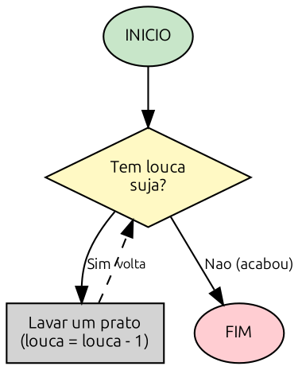

# Capítulo 3 — Laços e Repetições

**Objetivos deste capítulo:**

* Compreender o conceito de repetição em algoritmos
* Usar o laço `ENQUANTO` (while) para repetir enquanto uma condição for verdadeira
* Usar o laço `PARA` (for) para repetir um número conhecido de vezes
* Entender a diferença entre os dois tipos de laço
* Conhecer `INTERROMPER` (break) e `CONTINUAR` (continue)
* Evitar o temido **loop infinito**

***

## O que é repetição?

Imagine a seguinte cena.

Você chega em casa depois de um dia de trabalho. A pia está cheia de louça. Você suspira e começa: pega um prato, ensaboa, enxágua, seca, guarda. Depois pega o próximo prato, ensaboa, enxágua, seca, guarda. Depois outro. E outro. Até que a pia fique vazia.

O que você fez foi **repetir** a mesma sequência de ações para cada prato. Isso é um **laço de repetição** (ou **loop**).

Na programação, loops são essenciais porque resolvem um problema fundamental: **evitar repetir código**. Sem loops, para lavar 20 pratos você teria que escrever as mesmas instruções 20 vezes. Com um loop, você escreve uma vez e diz "repita isso para cada prato".

### Exemplos do dia a dia

| Atividade         | Ação que se repete      | Condição de parada              |
| ----------------- | ----------------------- | ------------------------------- |
| Lavar louça       | Lavar um prato          | Acabou a louça                  |
| Verificar e-mails | Ler um e-mail           | Não há mais e-mails não lidos   |
| Contar dinheiro   | Somar uma nota ao total | Acabaram as notas               |
| Escovar os dentes | Escovar um dente        | Escovou todos os dentes         |
| Pingar um IP      | Enviar um pacote        | Recebeu resposta ou deu timeout |

Perceba que toda repetição tem:

1. **Uma ação que se repete** — o que você faz a cada ciclo
2. **Uma condição de parada** — quando parar de repetir

***

## ENQUANTO — repita enquanto a condição for verdadeira

O primeiro tipo de laço é o `ENQUANTO` (while em inglês). A lógica é simples:

```
ENQUANTO <condição for verdadeira> FACA
    (ações que se repetem)
FIMENQUANTO
```

O computador verifica a condição. Se for verdadeira, executa o bloco. Depois **volta ao início** e verifica de novo. Continua repetindo até que a condição se torne falsa.

### Exemplo 1 — Lavar louça

```
INICIO
    louca_suja = 10   // 10 pratos na pia
	
    ENQUANTO louca_suja > 0 FACA
        Lavar um prato
        louca_suja = louca_suja - 1   // um prato a menos na pia
    FIMENQUANTO
	
    ESCREVER "Pia limpa!"
FIM
```

A cada volta, o `ENQUANTO` pergunta: "ainda tem louça suja?". Enquanto sim, lava mais um. Quando chegar a zero, a condição `louca_suja > 0` fica falsa e o laço termina.

### Exemplo 2 — Contagem regressiva

```
INICIO
    contador = 10
	
    ENQUANTO contador >= 0 FACA
        ESCREVER contador
        contador = contador - 1
    FIMENQUANTO
	
    ESCREVER "Foguete lancado!"
FIM
```

Esse algoritmo imprime: 10, 9, 8, 7, 6, 5, 4, 3, 2, 1, 0 e depois "Foguete lançado!".

### Exemplo 3 — Aguardando resposta

```
INICIO
    resposta = ""
	
    ENQUANTO resposta != "sim" E resposta != "nao" FACA
        ESCREVER "Digite 'sim' ou 'nao':"
        LER resposta
    FIMENQUANTO
	
    ESCREVER "Resposta registrada!"
FIM
```

Esse algoritmo fica pedindo uma resposta até que o usuário digite exatamente "sim" ou "nao". Qualquer outra coisa, ele repete. Isso é útil para **validar entrada** do usuário — um recurso importante em programas de segurança, onde entrada inválida pode ser uma porta de entrada para ataques.

### A armadilha do loop infinito

O que acontece se você escrever:

```
INICIO
    contador = 10
    ENQUANTO contador >= 0 FACA
        ESCREVER "Nunca vai parar!"
    FIMENQUANTO
FIM
```

Percebeu? O contador **nunca diminui**. A condição `contador >= 0` continua verdadeira para sempre, e o programa nunca sai do loop. Isso é um **loop infinito** — o programa trava, a tela fica congelada, e você precisa forçar o encerramento.

A regra de ouro: **dentro de um ENQUANTO, alguma variável precisa mudar de valor de modo que a condição possa se tornar falsa em algum momento**.

### Exercício 1 — Enquanto houver senha fraca

Uma empresa exige que os funcionários escolham senhas com pelo menos 8 caracteres. Escreva um algoritmo em Portugol que fique pedindo uma senha enquanto ela não tiver pelo menos 8 caracteres.

***

## PARA — repita um número fixo de vezes

O `ENQUANTO` é poderoso, mas tem um irmão que muitas vezes é mais prático: o `PARA` (for em inglês).

Use o `PARA` quando você **sabe exatamente quantas vezes** a repetição vai acontecer.

```
PARA variável DE inicio ATE fim FACA
    (ações que se repetem)
FIMPARA
```

### Exemplo 4 — Contar de 1 a 10

```
INICIO
    PARA cont DE 1 ATE 10 FACA
        ESCREVER cont
    FIMPARA
FIM
```

Isso imprime: 1, 2, 3, 4, 5, 6, 7, 8, 9, 10. O próprio `PARA` cuida de criar a variável `cont`, iniciar em 1, incrementar de 1 em 1, e parar quando chegar em 10.

### Exemplo 5 — Tabuada do 7

```
INICIO
    PARA n DE 1 ATE 10 FACA
        ESCREVER "7 x ", n, " = ", 7 * n
    FIMPARA
FIM
```

Saída: 7 x 1 = 7, 7 x 2 = 14, 7 x 3 = 21... até 7 x 10 = 70.

### Exemplo 6 — Somar notas de dinheiro

```
INICIO
    total = 0
    PARA nota DE 1 ATE 5 FACA
        ESCREVER "Digite o valor da nota ", nota, ":"
        LER valor
        total = total + valor
    FIMPARA
    ESCREVER "Total: R$", total
FIM
```

Aqui o `PARA` repete 5 vezes (pois você tem 5 notas para contar). A cada volta, pergunta o valor de uma nota e acumula no `total`.

***

## ENQUANTO vs PARA — quando usar cada um?

| Situação                                     | Use                       |
| -------------------------------------------- | ------------------------- |
| Você sabe exatamente quantas vezes           | `PARA`                    |
| A repetição depende de uma condição que muda | `ENQUANTO`                |
| Percorrer uma lista de itens                 | `PARA` (veremos no Cap 4) |
| Aguardar até que algo aconteça               | `ENQUANTO`                |
| Validar entrada do usuário                   | `ENQUANTO`                |
| Contar de 1 a 100                            | `PARA`                    |

Em geral: **prefira PARA quando o número de repetições é conhecido**. Use ENQUANTO quando a repetição depende de uma condição que pode mudar durante a execução.

### Exercício 2 — Identificando o tipo de laço

Para cada situação, diga se é melhor usar `PARA` ou `ENQUANTO`:

1. Imprimir os números pares de 2 a 100
2. Ficar perguntando a senha até o usuário acertar
3. Tentar conectar num servidor no máximo 3 vezes
4. Monitorar pacotes de rede até o usuário apertar Ctrl+C
5. Calcular a média de 4 notas bimestrais
6. Escanear portas de 1 a 1024

***

## Fluxograma de um loop

Um laço de repetição no fluxograma parece uma decisão que volta para trás:



Note o formato: a seta do "Sim" (ainda tem louça) **volta para cima**, criando um ciclo. A seta do "Não" (acabou a louça) **sai do loop** e segue para o fim.

***

## Laços aninhados — um loop dentro do outro

Assim como decisões podem estar dentro de decisões, loops podem estar dentro de loops. Isso se chama **laço aninhado**.

Imagine que você quer imprimir uma tabela de multiplicação:

```
INICIO
    PARA linha DE 1 ATE 5 FACA
        PARA coluna DE 1 ATE 5 FACA
            ESCREVER coluna * linha, " "
        FIMPARA
        ESCREVER "(fim da linha)"
    FIMPARA
FIM
```

O primeiro `PARA` (linha) executa 5 vezes. Dentro de cada execução, o segundo `PARA` (coluna) executa **mais 5 vezes**. Total: 25 impressões.

```
1  2  3  4  5  (fim da linha)
2  4  6  8  10 (fim da linha)
3  6  9  12 15 (fim da linha)
4  8  12 16 20 (fim da linha)
5  10 15 20 25 (fim da linha)
```

***

## Aplicações em Segurança — loops no mundo real

Agora vamos ver como esses conceitos se aplicam diretamente à segurança cibernética.

### Exemplo de segurança 1 — Scanner de portas (PARA)

Um scanner de portas tenta conectar em cada porta de um alvo para descobrir quais estão abertas. É um `PARA` clássico:

```
INICIO
    ip_alvo = "192.168.1.1"
    PARA porta DE 1 ATE 1024 FACA
        ESCREVER "Testando porta ", porta, " em ", ip_alvo
        // Aqui tentaria conectar (veremos como fazer em Python)
    FIMPARA
    ESCREVER "Varredura concluida"
FIM
```

Isso testa as portas de 1 a 1024 — as portas bem conhecidas. É exatamente o que ferramentas como nmap fazem, mas de forma mais sofisticada.

### Exemplo de segurança 2 — Tentativas de login (ENQUANTO)

```
INICIO
    tentativas = 0
    max_tentativas = 3
    autenticado = falso
	
    ENQUANTO tentativas < max_tentativas E NAO autenticado FACA
        ESCREVER "Digite a senha:"
        LER senha
        SE senha == "segredo" ENTAO
            autenticado = verdadeiro
        SENAO
            tentativas = tentativas + 1
            ESCREVER "Senha incorreta. Tentativa ", tentativas, " de ", max_tentativas
        FIMSE
    FIMENQUANTO
	
    SE autenticado ENTAO
        ESCREVER "Acesso liberado"
    SENAO
        ESCREVER "Conta bloqueada por excesso de tentativas"
    FIMSE
FIM
```

Esse algoritmo permite no máximo 3 tentativas. Depois disso, bloqueia a conta — exatamente como sistemas reais fazem para evitar ataques de força bruta.

### Exemplo de segurança 3 — Força bruta com dicionário

```
INICIO
    senhas = ["admin123", "senha", "123456", "password", "segredo"]
    encontrada = falso
    indice = 1
	
    ENQUANTO indice <= 5 E NAO encontrada FACA
        ESCREVER "Tentando: ", senhas[indice]
        SE senhas[indice] == "segredo" ENTAO
            encontrada = verdadeiro
            ESCREVER "Senha encontrada!"
        FIMSE
        indice = indice + 1
    FIMENQUANTO
	
    SE NAO encontrada ENTAO
        ESCREVER "Senha nao encontrada no dicionario"
    FIMSE
FIM
```

Isso é um ataque de **força bruta com dicionário**: testa uma lista pré-definida de senhas até encontrar a correta. Ferramentas como Hydra e John the Ripper fazem isso em escala muito maior.

***

## Interrompendo e pulando repetições

Às vezes você quer **sair do loop antes** da condição de parada natural, ou **pular uma iteração** sem sair do loop.

### INTERROMPER (break) — sair do loop imediatamente

```
INICIO
    PARA n DE 1 ATE 100 FACA
        ESCREVER n
        SE n == 5 ENTAO
            ESCREVER "Chega, parei no 5!"
            INTERROMPER   // sai do loop na hora
        FIMSE
    FIMPARA
    ESCREVER "Loop encerrado"
FIM
```

Isso imprime 1, 2, 3, 4, 5 e depois "Loop encerrado". Mesmo que o `PARA` estivesse programado para ir até 100, o `INTERROMPER` forçou a saída no 5.

### CONTINUAR — pular para a próxima repetição

```
INICIO
    PARA n DE 1 ATE 10 FACA
        SE n % 2 == 0 ENTAO
            CONTINUAR   // pula para o próximo número
        FIMSE
        ESCREVER n, " e impar"
    FIMPARA
FIM
```

Isso imprime apenas os números ímpares: 1, 3, 5, 7, 9. Quando `n` é par, o `CONTINUAR` **pula o resto do bloco** e vai direto para o próximo valor.

***

## Erros comuns com loops

### 1. Esquecer de atualizar a variável de controle

```pseudocode
// ERRADO — loop infinito!
contador = 1
ENQUANTO contador <= 10 FACA
    ESCREVER contador
    // faltou: contador = contador + 1
FIMENQUANTO
```

### 2. Condição que nunca fica falsa

```pseudocode
// ERRADO — "sim" nunca vira "nao"
resposta = "sim"
ENQUANTO resposta == "sim" FACA
    ESCREVER "Repetindo..."
    // resposta nunca muda!
FIMENQUANTO
```

### 3. Confundir PARA com ENQUANTO

```pseudocode
// Usar PARA quando nao sabe quantas vezes
PARA tentativa DE 1 ATE ? FACA  // Quantas? Nao sabemos
    ...tentar login...
FIMPARA

// Correto: usar ENQUANTO
ENQUANTO tentativas < max_tentativas E NAO logado FACA
    ...tentar login...
    tentativas = tentativas + 1
FIMENQUANTO
```

***

## Exercícios finais do capítulo

### Exercício 3 — Contagem regressiva de segurança

Um sistema de alarme dispara uma contagem regressiva de 30 segundos antes de acionar a polícia. Se o código de segurança for digitado durante a contagem, o alarme é cancelado.

Escreva em Portugol:

```
INICIO
    contagem = 30
    cancelado = falso
	
    ENQUANTO contagem >= 0 E NAO cancelado FACA
        ESCREVER "Alarme em ", contagem, " segundos"
        ESCREVER "Digite o codigo de seguranca (ou 999 para cancelar):"
        LER codigo
        SE codigo == 999 ENTAO
            cancelado = verdadeiro
        FIMSE
        contagem = contagem - 1
    FIMENQUANTO
	
    SE cancelado ENTAO
        ESCREVER "Alarme cancelado"
    SENAO
        ESCREVER "ALARME DISPARADO! Acionando policia..."
    FIMSE
FIM
```

O que acontece se o código 999 for digitado no segundo 15?

### Exercício 4 — Verificador de acesso por horário

Uma empresa libera acesso ao servidor apenas entre 8h e 18h. Escreva um algoritmo que pergunte a hora atual e:

* Se estiver dentro do horário comercial: exiba "Acesso liberado" e NÃO pergunte de novo
* Se estiver fora: exiba "Fora do horário. Tente novamente." e pergunte a hora novamente

Use `ENQUANTO` para garantir que só libera quando o horário for válido.

### Exercício 5 — Tabela ASCII

A tabela ASCII associa números a caracteres. Por exemplo, o número 65 corresponde à letra 'A', o 66 ao 'B', e assim por diante.

Escreva um algoritmo que imprima os caracteres de 65 (A) a 90 (Z). Use `PARA`.

### Exercício 6 — Scanner de portas com timeout

Um scanner de portas testa as portas de 1 a 1000. Se encontrar uma porta aberta, registra e **continua escaneando**. Se encontrar uma porta com serviço crítico (22, 80, 443), **interrompe tudo** e dispara alerta.

Escreva em Portugol usando `PARA`, `SE` e `INTERROMPER`.

Dica: dentro do `PARA`, use um `SE` para verificar se a porta é uma das críticas e `INTERROMPER` se for.

### Exercício 7 — Identificando o erro

Cada bloco abaixo tem um erro. Identifique e corrija:

```pseudocode
// Bloco A
x = 1
ENQUANTO x < 10 FACA
    ESCREVER x
FIMENQUANTO

// Bloco B
PARA i DE 1 ATE 5 FACA
    ESCREVER "Volta ", i
    SE i == 3 ENTAO
        ESCREVER "Parou no 3"
        CONTINUAR
    FIMSE
FIMPARA

// Bloco C
ENQUANTO verdadeiro FACA
    ESCREVER "Loop eterno"
FIMENQUANTO
```

***

## Resumo do Capítulo

* **Loop** é uma estrutura que repete um bloco de instruções
* **ENQUANTO (while)** repete **enquanto** uma condição for verdadeira — use quando não sabe quantas vezes
* **PARA (for)** repete um número **determinado** de vezes — use quando sabe exatamente quantas
* **INTERROMPER (break)** sai do loop imediatamente
* **CONTINUAR (continue)** pula para a próxima iteração
* **Loop infinito** acontece quando a condição nunca se torna falsa — sempre verifique se a variável de controle está sendo atualizada
* Laços podem ser **aninhados** (um dentro do outro)
* Aplicações em segurança: scaneamento de portas (`PARA`), força bruta (`ENQUANTO`), validação de entrada (`ENQUANTO`)

No próximo capítulo vamos aprender sobre **vetores, listas e funções** — como armazenar múltiplos valores e organizar o código em blocos reutilizáveis.
